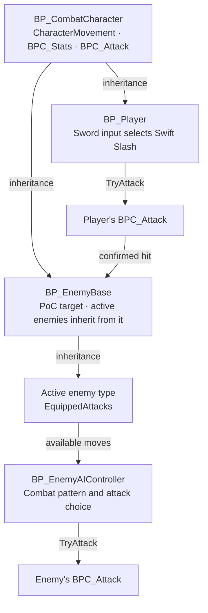

# Combat Architecture

## Combat proof of concept

**Objective** — Prove that Natanael can land one readable sword hit with the Pistoblade. Use **Swift Slash**, the ground sword beginner from the move catalogue, against a stationary target with HP.

| Check | Expected result |
| --- | --- |
| Press the sword attack input | Natanael plays the Swift Slash montage. |
| The blade reaches the target during the hit window | The target loses HP once for that swing, even if the blade stays in contact for several frames. |
| Swing out of reach or contact the target outside the hit window | The attack ends normally and the target keeps its HP. |

## Blueprint responsibilities

Blueprint and component names are provisional.

| Blueprint or component | Responsibility                                                                                                                                                                                       |
| ---------------------- | ---------------------------------------------------------------------------------------------------------------------------------------------------------------------------------------------------- |
| `BP_CombatCharacter`   | Shared character base. It owns `CharacterMovement`, `BPC_Stats` and `BPC_Attack`, and exposes `ReceiveHit`.                                                                                          |
| `BPC_Stats`            | Stores maximum and current HP, applies HP loss and signals when HP reaches zero.                                                                                                                     |
| `BPC_Attack`           | Executes `TryAttack(Attack)`. It plays the montage, checks for hits during the active window and sends damage to each confirmed target. It closes the window when the attack ends or is interrupted. |
| `BP_Player`            | Reads the player's input. For the PoC, the sword input requests Swift Slash directly.                                                                                                                |
| `BP_EnemyBase`         | Serves as the PoC target. Active enemy types inherit from it and define their own equipped attacks.                                                                                                  |
| `BP_EnemyAIController` | Drives active enemies. It follows their combat pattern and chooses when to request an equipped attack.                                                                                               |

## Enemy patterns and equipped attacks

Start the first active enemy with one equipped move. A rat, for example, can approach Natanael, telegraph a bite, attack and recover. Its `AIController` decides when the rat is in reach, then calls `TryAttack` and waits for the attack to end before moving on to recovery. A later pattern can choose a different move based on distance or request a fixed sequence of attacks.

An `ST_Attack` describes one move. For the PoC it contains the montage and damage. When a move is shared, a Data Asset such as `DA_Sweep` can hold that definition. Two enemy types can equip the same Sweep by referencing that asset in their `EquippedAttacks` lists. Each enemy owns its equipped list and its own `BPC_Attack`, including its current swing and hit tracking. If the two enemies need different montages, each can equip a variant of the move with a compatible montage.

## Player combo development

Add `BPC_PlayerCombo` to `BP_Player` when the first multi-hit combo is in scope. It selects the next equipped move and passes it to `BPC_Attack`. The normal ground sequence begins with a **Beginner**, continues through the ordered **Followers**, then ends on a **Finisher**. Each slot can be changed individually when alternative moves are available. Enemy sequences are chosen by their AI patterns.

Later combat work includes the Pistoblade's pistol mode, interchangeable weapons, and the style rank and stagger rules.
